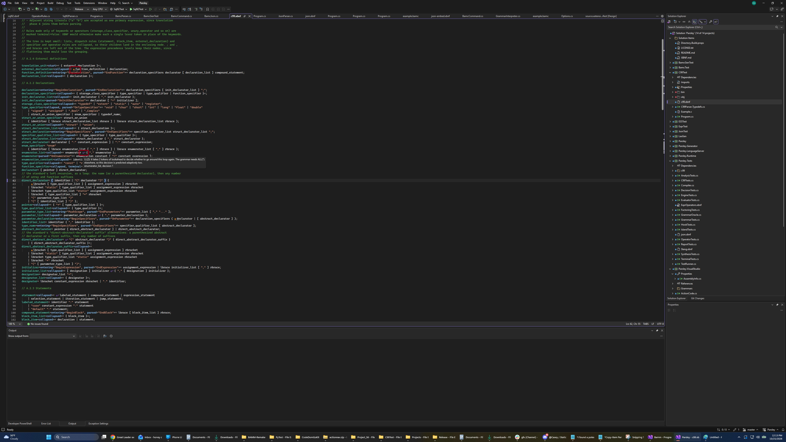

# Parsley

A parser generator utilizing code synthesis. It looks at what each grammar actually needs and synthesizes the lightest parser that can do it: LL(1), LL(k), or ALL(\*).

## Install

For the main Parsley tool
`dotnet tool install parsley-tool -g`

If you want to use Luthor lexing with Parsley
`dotnet tool install parsley-luthor -g`

If you want to use the C# Source Generator instead:
`dotnet add package Parsley.Generator`

If you want to use the Visual Studio XBNF Language support
https://marketplace.visualstudio.com/items?itemName=honey-the-codewitch.parsley123

Or for VS Code
https://marketplace.visualstudio.com/items?itemName=honey-the-codewitch.parsley-xbnf-lsp

## Use

```
parsley

Usage: parsley [<grammar-file>] [--lexer <lexer-file>] [--output <code-file>] [--shared] [--base] [--engine <engine>]

    <grammar-file>            The path to the XBNF grammar input file. Defaults to <stdin>.
    -l, --lexer <lexer-file>  The lexer output file to generate. Terminals from other lexers (lexer=Name) go in files beside it.
    -o, --output <code-file>  The path to the ouput code file. Defaults to <stdout>.
    -s, --shared              Generate the shared runtime: ParsleyRuntime.cs and the parser base class for the grammar's engine.
    -b, --base                Generate only the parser base class for the grammar's engine.
    -e, --engine <engine>     auto (the default), ll1, llk or allstar.
    -r, --report              Write a report on the grammar instead of a parser.
```

`-r` writes a plain text report to stdout instead of a parser. It covers:
- the engine the grammar needs and why, and the decisions that need it;
- whether each engine could parse the grammar;
- counts of productions, terminals and decisions, broken down by kind and lookahead;
- one row per production;
- the size of the synthesized code and what it costs at parse time.

It can't be combined with `-o`, `-l`, `-s` or `-b`. `GrammarReport.Create(analysis)` produces the same report in code.

- The grammar file is in XBNF, a superset of EBNF with some extra convenience operators and attributes and semantic actions (potentially C# code in the grammar to create an evaluator)
- The lexer file is generated if specified and contains 1 rule per line, `<name>` `<pattern>` (separated by a space) and hidden terminal names are preceded with `.` as in `.whitespace`. `parsley-luthor` turns it into a lexer whose `Tokenize` reports each terminal's id in that order, and text it can't match as -1, which is what Parsley expects of any lexer.
- The output code file is a C# class that derives from the base class for its engine (`LL1ParserBase`, `LLkParserBase` or `AllStarParserBase`) and has a `Parse()` method returning a `ParseNode`. It may also generate an evaluator class with an `Evaluate()` method if semantic actions are present.
- The shared runtime file is `ParsleyRuntime.cs`, which contains `Token`, `LookAheadEnumerator`, `ParseNode`, `ParseError`, `ParserTables`, the abstract `ParserBase` that holds what every engine shares (tree building, error reporting and recovery), and the `LexerController` that lexes grammars with islands. Each engine's base class is its own file: `LL1ParserBase.cs`, `LLkParserBase.cs` or `AllStarParserBase.cs`.
- `-s` writes `ParsleyRuntime.cs` and the engine's base class file. `-b` writes only the base class file, for a project that already has `ParsleyRuntime.cs` from another parser. A project with parsers on different engines needs `-s` once, then `-b` for each engine it adds. Both write next to the grammar file, or in the current directory if the grammar comes from stdin.

## Engines

With `-e auto` (the default), Parsley picks the lightest engine the grammar allows:

| Engine | Chosen when | Base class | What it costs |
| --- | --- | --- | --- |
| LL(1) | Every decision is made by the current token | `LL1ParserBase` | Nothing: tokens are read straight from the lexer, no lookahead buffer |
| LL(k) | Every decision is settled within 4 tokens (or the grammar's `@maxk`) | `LLkParserBase` | A small lookahead buffer, and a synthesized predictor method per decision that needs more than one token |
| ALL(\*) | Some decision can't be settled by any fixed number of tokens | `AllStarParserBase` | The grammar's transition network as a table, and adaptive prediction at parse time for decisions that need more than one token |

All three produce the same tree and the same errors for any grammar they can all parse, and evaluators work the same way on every engine. In an ALL(\*) parser, one-token decisions are still plain `switch` and `if` tests; only the decisions that need more lookahead call `AdaptivePredict`. That simulates the grammar over as much input as it takes. It ignores the calling context first, and caches the result per decision, so after warm-up most predictions are a few dictionary lookups. It retries with the parser's real call stack only when that context-free pass is inconclusive.

When a decision that looks more than one token ahead meets input none of its branches matches, every engine parses
the branch that matched the most of it: the default one (an empty alternative, skipping an optional, or leaving a
loop) if it got as far, else the earliest. So the error is reported at the token where the input goes wrong,
expecting what that branch could take there, not at the start of the decision. Only input that no branch can even
start with is reported where the decision begins.

A decision that is really ambiguous, where the same input fits two branches all the way through, comes out the way the default policies say: the first alternative wins, and a loop or optional keeps matching. A `<policy>` on the decision settles it when the grammar is analyzed instead, on every engine, so a construct like the dangling `else` can stay LL(1). See [Ambiguity](XBNF.md#ambiguity).

How much lookahead counts as "fixed" is up to the grammar: `@maxk 2;` caps it at 2 tokens, and the default is 4. It's a directive rather than a command line switch so that a grammar always synthesizes the same parser. The analysis only follows the inputs on which a decision's branches still overlap, so even a grammar like C99, which has around 80 keywords and operators, takes a few seconds at k=4.

`-e ll1`, `-e llk` and `-e allstar` force an engine. LL(1) and LL(k) then settle what they can't decide the way Parsley always did: by policy, with an error for an alternation that has none. Forcing ALL(\*) on an LL(k) grammar makes every multi-token decision adaptive.

In code, `GrammarAnalysis.Analyze(grammar, ParserEngine.Auto)` makes the choice and reports it in `analysis.Engine`. `CSharpSynthesizer.RuntimeSource`, `BaseSource(engine)` and `BaseFileName(engine)` give you the runtime files.

The documentation for XBNF is [here](XBNF.md).

Operators can be written in one rule, tightest first, instead of one rule per level of precedence. A rule marked `<operators>` is parsed by precedence climbing; `assoc=right` makes an operator right associative, and an operator can have a production of its own, for its own node and semantic action. See [Operator rules](XBNF.md#operator-rules), and `Parsley/Expr.xbnf`, which is `ExprLong.xbnf` written that way.

For languages whose parse depends on what's been parsed so far, such as C, where a name can be a type or a variable, rules can call your C# as they're parsed (`entering`, `parsed`, `matched`), and a contextual terminal (`when`) lets that code decide what a token is. See [Parse-time hooks](XBNF.md#parse-time-hooks-and-contextual-terminals), and `Parsley.Tests/c99` for a C99 grammar that uses them.

For text in more than one language, a grammar can embed another as an island: `@external Json "json.xbnf";` declares it, and a rule with no body, such as `Headers<entry="Json.Object", after="addHeadersKeyword", nest="Json.lbrace", pop="Json.rbrace">;`, says where the island starts and ends. A terminal can also come from another lexer where the token before says so (`lexer=`, `on=`, `when=`), as a JavaScript regular expression does. A lexer controller in the runtime switches lexers as it lexes, so the lexers stay ordinary Luthor (or any) lexers and the parser just reads tokens. See [Islands and other lexers](XBNF.md#islands-and-other-lexers), `BamcTest` for bamc scripts that embed JSON, and `BamcGenTest` for the same through the source generator.

The synthesized class plus `ParsleyRuntime.cs` and its base class file compile on their own (C# 12, .NET 8), with no reference to Parsley:

```csharp
try 
{
    var tree = JsonParser.Parse(tokens);   // IEnumerable<Token> straight from the lexer
    Console.WriteLine(tree);
}
catch(Parsley.Runtime.ParseException ex) {
    foreach (var e in ex.Errors) Console.WriteLine(e);
}
```

Token ids: the lexer numbers terminals from 0 in the grammar's terminal order (hidden and implicit ones
included, implicit ones last), and the parser adds `ParserTables.TerminalStart` (the number of non-terminals)
as each token arrives. A lexer reports text it can't match as -1; a negative id, or one past the last terminal, is
reported as unrecognized input.

Terminals: a rule whose right side is a lone `"literal"` or `'pattern'` is a terminal; anything else is a
non-terminal unless `<terminal>` forces it (it may then combine literals and patterns and reference other
terminals, which are inlined), and `<terminal=false>` forces a non-terminal. Each `TerminalDeclaration` keeps its `Definition` expression and a `Regex` for your lexer
generator: patterns pass through unvalidated with the quotes removed (`\'` becomes `'`), literals are escaped,
and other definitions are built from their constructs.

## Build and test

Open `Parsley.sln` in Visual Studio, or run `dotnet build Parsley.sln`.

You need dotnet 8 installed to execute the build steps due to luthor being compiled for that framework.

## Language Services

The languages server for XBNF provides syntax highlighting, completion, navigation, and inline analysis for your grammars. It is available through a VS Code extension and for Visual Studio 2022 and 2026

